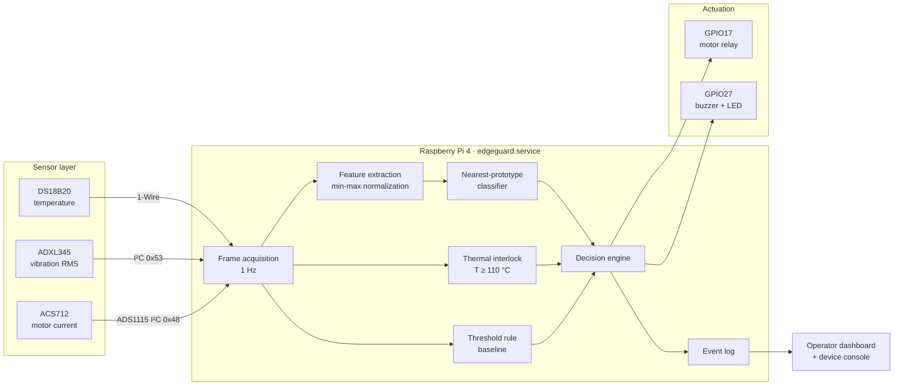
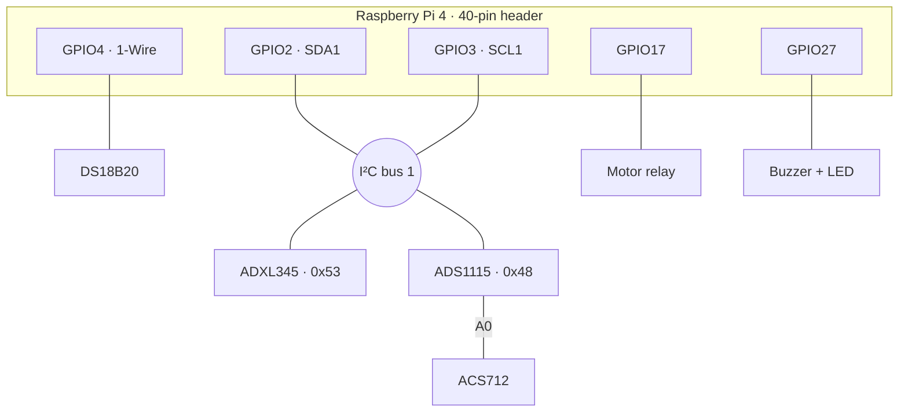
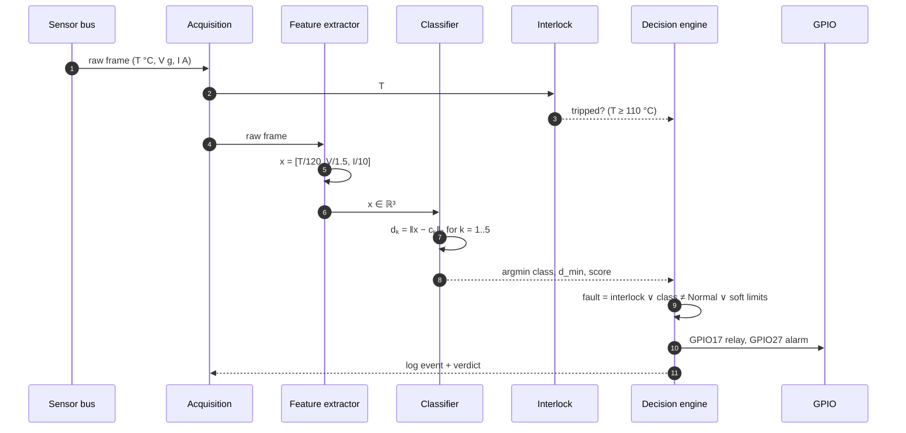
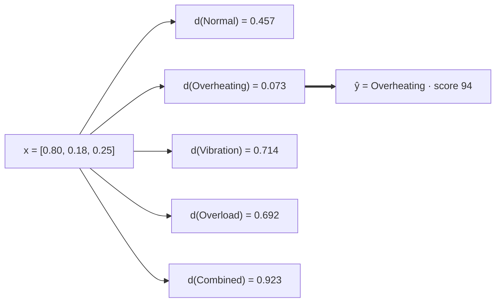
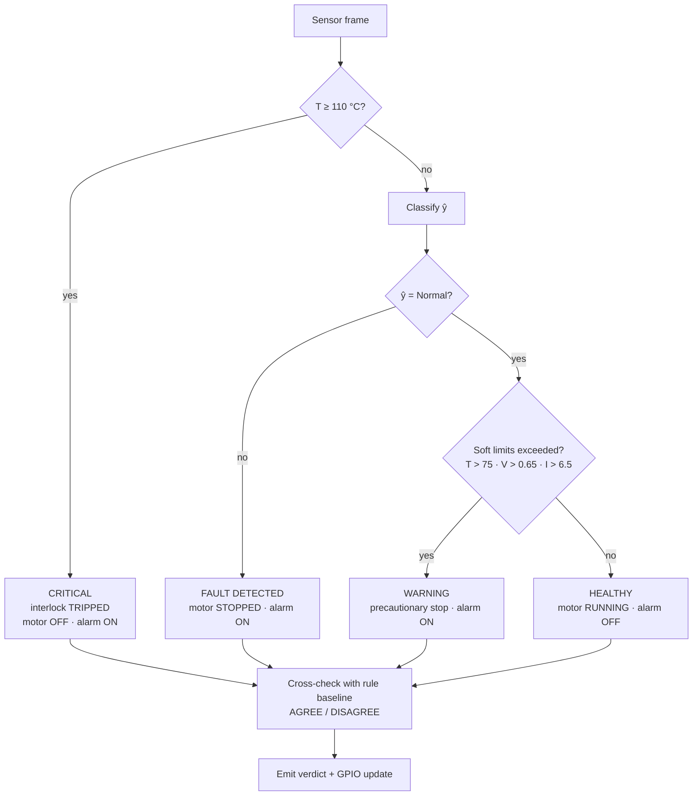
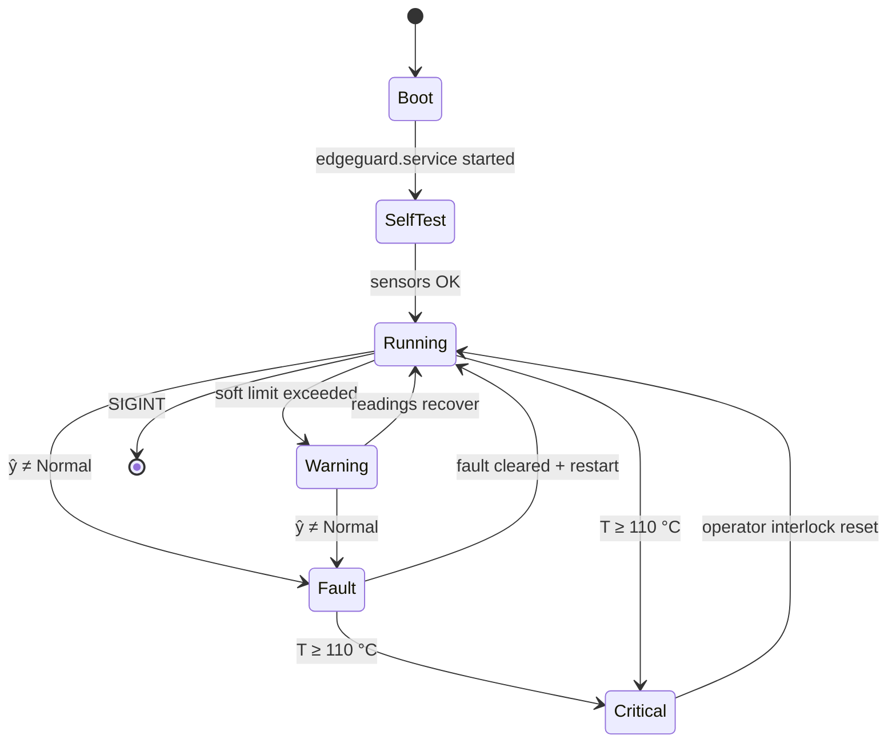
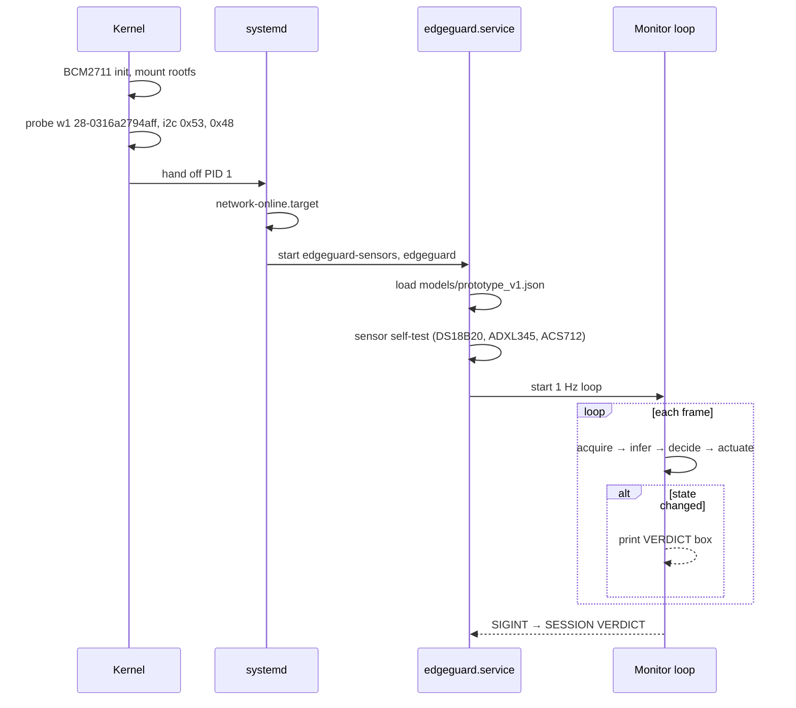
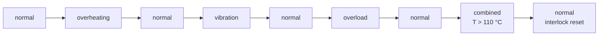
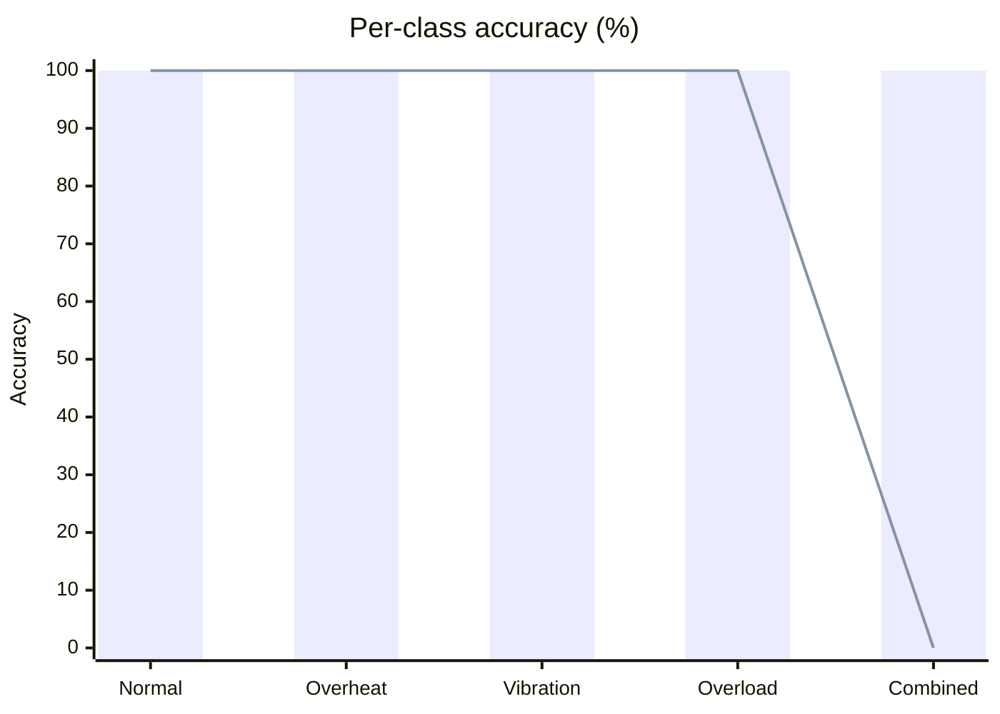
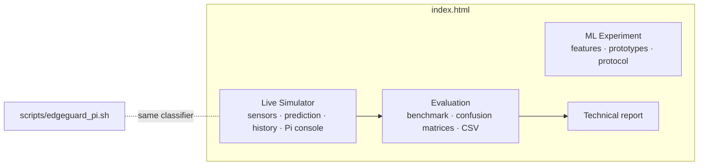

# EdgeGuard AI

**Edge inference for industrial motor fault detection on a Raspberry Pi 4 sensor node.**

EdgeGuard AI fuses three sensor channels (temperature, vibration RMS and motor current) into a normalized feature vector. A nearest-prototype classifier runs entirely on the node and assigns each frame one of five operating states. An independent hardware interlock and GPIO actuation stop the motor and raise an alarm the moment a fault is detected, with no cloud round-trip.

    

---

## Contents

- [System architecture](#system-architecture)
- [Hardware profile](#hardware-profile)
- [Inference pipeline](#inference-pipeline)
- [Classifier](#classifier)
- [Decision and safety logic](#decision-and-safety-logic)
- [Device state machine](#device-state-machine)
- [Node runtime and boot sequence](#node-runtime-and-boot-sequence)
- [Benchmark results](#benchmark-results)
- [Repository layout](#repository-layout)
- [Getting started](#getting-started)
- [Device console reference](#device-console-reference)
- [Roadmap](#roadmap)

---

## System architecture



All inference happens on the node. The decision engine combines three independent signals:

| Path | Purpose | Authority |
|---|---|---|
| Thermal interlock | Hard emergency cutoff | Highest. It cannot be overridden by the model |
| Nearest-prototype classifier | Multi-class fault identification | Primary classification |
| Threshold rule baseline | Cross-check and agreement reporting | Advisory |

---

## Hardware profile

| Component | Part | Interface | Address / pin | Signal |
|---|---|---|---|---|
| SBC | Raspberry Pi 4 Model B (BCM2711, 4× Cortex-A72 @ 1.5 GHz, 4 GB) | n/a | n/a | n/a |
| Temperature | DS18B20 | 1-Wire (`w1-gpio`) | `28-0316a2794aff` | °C |
| Vibration | ADXL345 3-axis accelerometer | I²C bus 1 | `0x53` | RMS, g |
| Current | ACS712 Hall-effect sensor | via ADS1115 16-bit ADC, I²C bus 1 | `0x48`, ch A0 | A |
| Motor relay | Relay module | GPIO | `GPIO17` | HIGH = run, LOW = stop |
| Alarm | Buzzer + LED | GPIO | `GPIO27` | HIGH = active |



---

## Inference pipeline

Per-frame execution path at 1 Hz:



---

## Classifier

### Feature vector

Each channel is scaled into a comparable range, so that no single unit dominates the distance metric:

$$
\mathbf{x} = \left[\frac{T}{120},\ \frac{V_{rms}}{1.5},\ \frac{I}{10}\right] \in \mathbb{R}^3
$$

### Class prototypes

| Class | $c_1$ (temp) | $c_2$ (vib) | $c_3$ (current) |
|---|---|---|---|
| Normal operation | 0.35 | 0.12 | 0.20 |
| Overheating | 0.80 | 0.20 | 0.32 |
| Excessive vibration | 0.42 | 0.78 | 0.32 |
| Electrical overload | 0.45 | 0.32 | 0.83 |
| Combined fault | 0.88 | 0.85 | 0.88 |

### Decision rule

$$
d_k(\mathbf{x}) = \lVert \mathbf{x} - \mathbf{c}_k \rVert_2 = \sqrt{\sum_{i=1}^{3}(x_i - c_{k,i})^2}
\qquad
\hat{y} = \arg\min_k d_k(\mathbf{x})
$$

Similarity score reported with each prediction:

$$
s = \operatorname{clip}\!\left(100\left(1 - \frac{d_{\min}}{1.25}\right),\ 50,\ 99\right)
$$

| Property | Value |
|---|---|
| Parameters | 15 (5 prototypes × 3 features) |
| Model size | 0.6 KB |
| Complexity | $O(k \cdot d)$ per frame, $k = 5$, $d = 3$ |
| Hardware requirements | CPU only, no accelerator |
| Determinism | Fully deterministic, so every prediction is explainable by its distance vector |



---

## Decision and safety logic



The interlock is evaluated on the raw temperature, before the classifier output is considered. So no classification outcome can block an emergency stop.

**Rule baseline thresholds:** T ≥ 85 °C, V ≥ 0.75 g, I ≥ 7.0 A.

---

## Device state machine



| State | GPIO17 relay | GPIO27 alarm | Interlock |
|---|---|---|---|
| Running | HIGH | LOW | ARMED |
| Warning | LOW | HIGH | ARMED |
| Fault | LOW | HIGH | ARMED |
| Critical | LOW | HIGH | TRIPPED |

---

## Node runtime and boot sequence

`scripts/edgeguard_pi.sh` runs the node lifecycle end to end in a terminal: kernel boot, systemd bring-up, sensor self-test, model load, then the 1 Hz monitor loop with scenario injection and per-transition verdicts.



Scenario schedule in the monitor loop:



---

## Benchmark results

Evaluated on `data/benchmark_25.csv`: 25 labelled frames, 5 per class.

| Method | Accuracy | Correct |
|---|---|---|
| **Nearest-prototype classifier** | **100%** | 25 / 25 |
| Threshold rule baseline | 80% | 20 / 25 |

Mean inference latency is about 0.02 ms per frame.

**Classifier confusion matrix**

| Actual \ Predicted | Normal | Overheating | Vibration | Overload | Combined |
|---|---|---|---|---|---|
| Normal | **5** | 0 | 0 | 0 | 0 |
| Overheating | 0 | **5** | 0 | 0 | 0 |
| Vibration | 0 | 0 | **5** | 0 | 0 |
| Overload | 0 | 0 | 0 | **5** | 0 |
| Combined | 0 | 0 | 0 | 0 | **5** |

The rule baseline misses all 5 combined-fault frames. Independent per-channel thresholds produce multi-flag or interlock labels instead of a single combined class. The prototype model separates them because it uses the joint position in feature space.



<sub>Bars: prototype classifier · line: threshold baseline</sub>

The **Evaluation** tab reproduces these numbers in the browser and exports per-sample results as CSV.

---

## Repository layout

```
edgeguard-ai/
├── index.html              # Operator dashboard, device console, evaluation bench, report
├── scripts/
│   └── edgeguard_pi.sh     # Node runtime: boot → service → 1 Hz monitor loop
├── models/
│   └── prototype_v1.json   # Prototypes, normalization, interlock + GPIO config
├── data/
│   └── benchmark_25.csv    # Labelled evaluation frames (5 per class)
├── LICENSE
└── README.md
```



---

## Getting started

### Dashboard

There are no dependencies and no build step.

```bash
git clone https://github.com/tkshsbcue/edgeguard-ai.git
cd edgeguard-ai
open index.html            # macOS  ·  xdg-open index.html on Linux
```

Or serve it locally:

```bash
python3 -m http.server 8000   # → http://localhost:8000
```

### Node runtime

```bash
bash scripts/edgeguard_pi.sh            # full boot + monitor (~60 s)
bash scripts/edgeguard_pi.sh --fast     # ~3× speed
bash scripts/edgeguard_pi.sh --no-boot  # skip straight to the monitor loop
bash scripts/edgeguard_pi.sh --loop     # cycle scenarios until Ctrl+C
```

| Flag | Effect |
|---|---|
| `--fast` | Runs about 3× faster |
| `--no-boot` | Skips the kernel and systemd stage |
| `--loop` | Repeats the scenario schedule indefinitely |
| `--no-color` | Plain output, for logs and CI |
| `-h` | Prints help |

Requires `bash` and `awk` (macOS, Linux, WSL or Git Bash).

---

## Device console reference

The dashboard includes an SSH-style console to `pi@edgeguard-pi`. Commands can be clicked or typed.

| Command | Description |
|---|---|
| `ssh pi@edgeguard-pi.local` | Opens a session to the node |
| `neofetch --off` | Shows board, kernel, CPU, memory and network |
| `vcgencmd measure_temp` | Shows SoC temperature and throttle state |
| `systemctl status edgeguard` | Shows inference service health |
| `python3 sensors.py --read` | Reads the DS18B20, ADXL345 and ACS712 |
| `python3 sensors.py --inject <scenario>` | Injects `normal`, `heat`, `vibration`, `current` or `combined` |
| `python3 edgeguard.py --load-model` | Loads the classifier into memory |
| `python3 edgeguard.py --infer` | Classifies the live frame and prints the distance vector and **VERDICT** |
| `python3 edgeguard.py --test-all` | Runs the 5-scenario suite and prints the **SUITE VERDICT** |
| `python3 evaluate.py` | Runs the 25-sample benchmark and prints the **MODEL VERDICT** |
| `ls` · `pwd` · `uptime` · `whoami` · `clear` · `exit` | Shell utilities |

---

## Roadmap

- [ ] Fit prototypes from field-recorded sensor logs (k-means per class)
- [ ] Anomaly score for out-of-distribution frames
- [ ] Export to TensorFlow Lite Micro for MCU targets
- [ ] MQTT telemetry for fleet dashboards
- [ ] FFT-based vibration features (bearing-fault bands)

---

## License

MIT © Kumar Tanay
